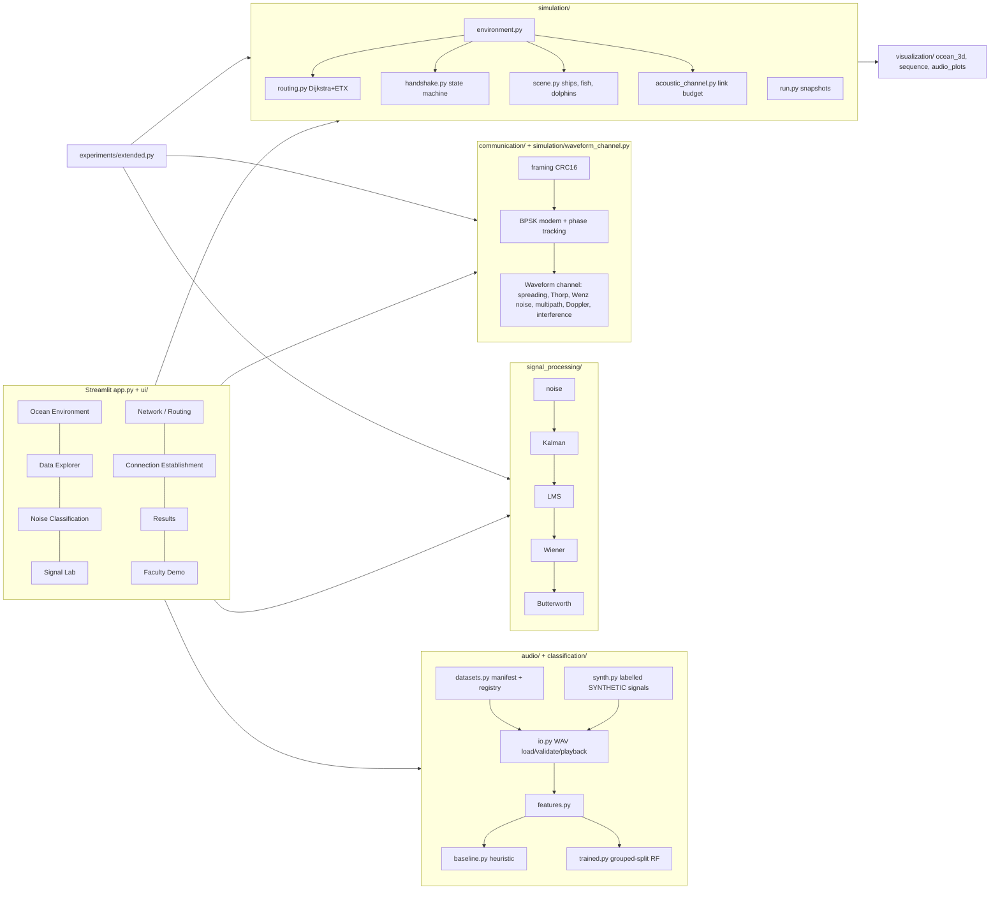
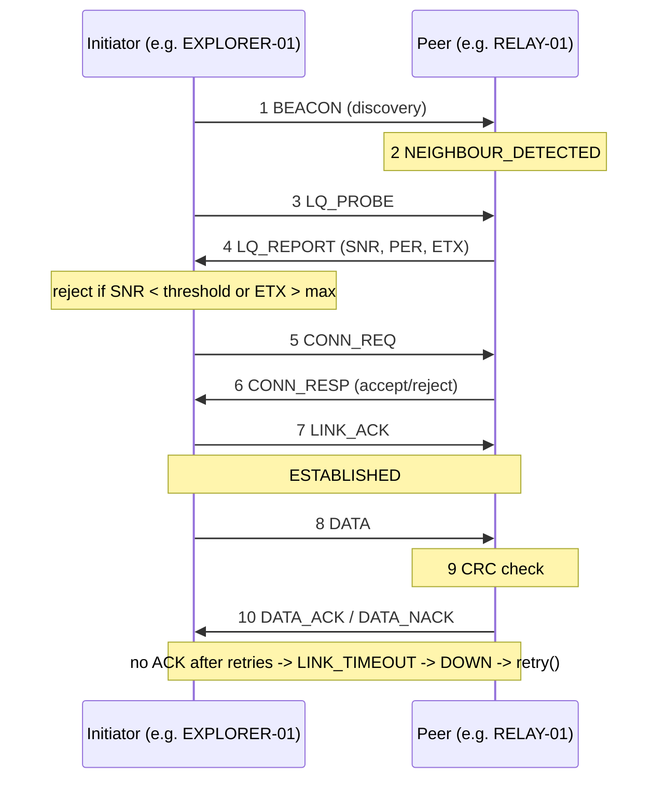

# System architecture

Two channel models coexist on purpose:

| Model | Where | Used for | Detail |
|---|---|---|---|
| Link budget (`acoustic_channel.py`) | network simulation | per-hop SNR, PER, ETX, routing | SNR = SL - TL - NL; Eb/N0 := SNR (valid when noise bandwidth = bit rate) |
| Waveform channel (`waveform_channel.py`) | Connection Establishment page, experiments | actual BPSK waveforms, BER/PER | measured at sample level; validated against AWGN BPSK theory |

`experiments/extended.py::exp_model_vs_waveform` compares them.

## Connection-establishment sequence (proposed simulator protocol)

Every arrow takes propagation delay (distance / 1500 m/s) plus transmission time and may be lost with the packet-error probability of its frame size.
